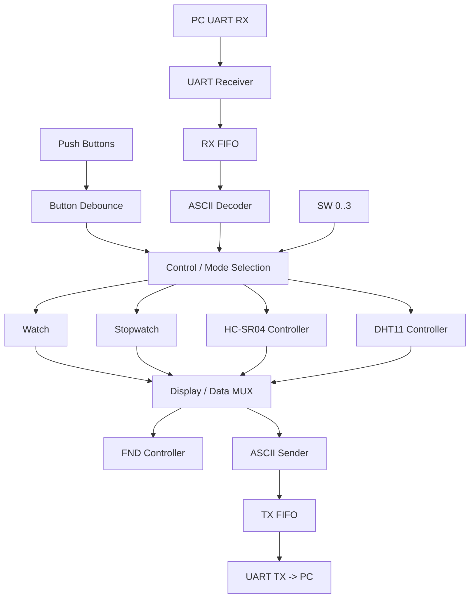
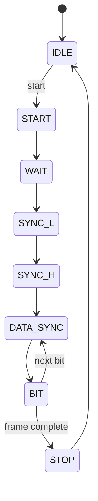
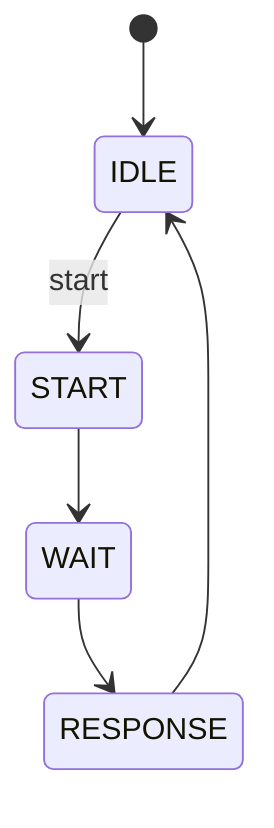
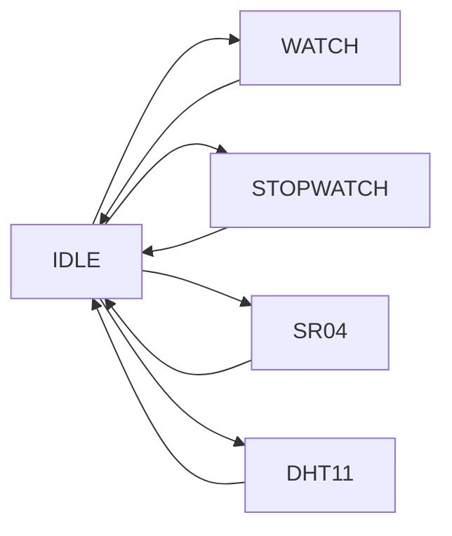

# 설계 구조 / Architecture

## 시스템 연결

> 위 도식은 상위 데이터 흐름을 설명하는 개념도입니다. 실제 인스턴스별 핀 연결은 `top_all.v`와 각 모듈을 기준으로 확인합니다.

## DHT11 Controller FSM

8개 상태 구성은 원본 소스의 상태 이름 기준입니다. 상태 전이 조건과 타이밍은 RTL에서 확인하세요.

## HC-SR04 Controller FSM

TRIG 신호 생성과 ECHO의 펄스 폭 측정을 포함하는 4상태 설계입니다.

## ASCII Sender

위 화살표는 기능별 선택과 종료를 단순화한 것으로, RTL의 모든 분기 조건을 표현하는 정확한 ASM 차트는 아닙니다.

## 파일 관리

- `src/`: 프로젝트 원본 RTL
- `sim/`: 기능별 테스트벤치(확보 후 추가)
- `constraints/`: 보드 XDC(확보 후 추가)
- `docs/`: FSM/ASM, 다이어그램, 설계·검증 기록

## 보충 사항

- 센서 타이밍, FIFO 포인터, 비트 샘플링은 Vivado 시뮬레이션에서 검증해야 합니다.
- GitHub 내 문서 생성 자체는 합성 PASS, 비트스트림 생성 성공 또는 실물 보드 동작의 증거가 아닙니다.
